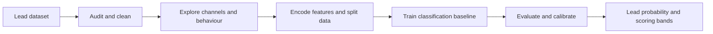

# Lead Conversion Prediction and Marketing Analytics

> A marketing analytics project exploring how lead behaviour and acquisition channels can inform the prediction of customer conversion and the design of an interpretable lead scoring system.

**Status:** Exploratory notebook and formal project scope available. A fully evaluated, deployable classification and scoring pipeline is not yet established.  
**Tools:** Python, pandas, scikit-learn, Jupyter and Marimo.

## Executive Summary

Sales and marketing teams need to understand which prospective customers are likely to convert so they can allocate attention more effectively. This project uses lead-level attributes to frame a binary classification problem, examine acquisition and behavioural patterns, and plan an interpretable probability-based lead scoring workflow.

The repository currently contains the source dataset, `notebook.ipynb`, a Marimo notebook exported as `notebook.py`, and a detailed implementation plan in `SCOPE_OF_WORK.md`. The scope document identifies modelling, evaluation, calibration and deployment milestones. Those milestones must not be mistaken for finished results.

## Business Problem and Objectives

**Target:** `Converted`, where 1 indicates conversion and 0 indicates non-conversion.

The project seeks to investigate the relationship between conversion and lead characteristics, establish an interpretable logistic regression baseline, evaluate ranking and classification performance, and eventually provide a transparent scoring mechanism for prioritising outreach.

Important business metrics include precision and recall, ROC AUC, precision among the highest-ranked leads, and probability calibration. A high model score alone does not establish increased revenue or campaign effectiveness.

## Dataset

The repository includes `Leads.csv`, described in the existing documentation as originating from the [Kaggle Leads Dataset](https://www.kaggle.com/ashydv/leads-dataset). Example fields include lead source, total visits, page views per visit, total time on website, last activity and lead quality. Review label availability and feature timestamps to prevent using information only known after conversion.

## Project Architecture



The complete workflow above is the **intended design**, not a verified deployed system.

## Current Implementation and Planned Work

| Component | Current evidence | Status |
| --- | --- | --- |
| Source leads dataset | `Leads.csv` | Available |
| Research notebooks | `notebook.ipynb`, `notebook.py` | Present |
| Problem formulation and staged work plan | `SCOPE_OF_WORK.md` | Documented |
| Logistic regression model | Imports and planned baseline sections | Not independently verified as trained and evaluated |
| Accuracy, precision, recall, F1 and ROC AUC | Original README uses `XX.XX` placeholders | No validated numbers to publish |
| Lead probability bands | Proposed thresholds above 0.70 and 0.40 | Proposed, not validated |
| Saved trained model, scoring CLI or Streamlit application | Listed as intended deliverables | Not present as deliverables |

The original README describes completed preprocessing, SMOTE, performance, exported models and a Streamlit app without showing the corresponding artifacts. This revision removes those unsupported completion claims.

## Methodology and Validation Plan

1. Audit missing values, target balance and duplicates.
2. Split records before fitting imputers, encoders or resampling procedures.
3. Build a logistic regression baseline with an auditable preprocessing pipeline.
4. Compare precision, recall, F1, ROC AUC and PR AUC, alongside a majority-class baseline.
5. Evaluate top-decile or top-quintile precision and calibrate probability estimates.
6. Examine coefficients for associations, not causal marketing effects.
7. Select lead scoring thresholds against realistic outreach capacity and costs.
8. Save the fitted pipeline and produce an example scoring output after validation.

SMOTE, if required, must operate on training folds only. Accuracy and threshold figures should not be reported until calculated on a held-out dataset.

## Repository Structure

```text
README.md
Leads.csv
notebook.ipynb
notebook.py
SCOPE_OF_WORK.md
requirements.txt
.venv/              # Local environment currently tracked
docs/
    legacy-readme.md
```

**Repository hygiene:** A complete `.venv/` directory is tracked in Git. It should be excluded from version control, and files should be inspected for credentials or sensitive content before removal from the repository's history.

## Getting Started

```bash
git clone https://github.com/TeslimAdeyanju/Lead-Conversion-Model.git
cd Lead-Conversion-Model
python3 -m venv .venv-local
source .venv-local/bin/activate
python -m pip install -r requirements.txt
jupyter notebook notebook.ipynb
```

`notebook.py` is a Marimo application and may be opened with `marimo edit notebook.py` if the environment provides Marimo. The commands have not been independently tested end to end. Consult `SCOPE_OF_WORK.md` for the project's implementation sequence.

## Limitations and Future Development

- Complete an independently reproducible training and evaluation workflow.
- Publish actual test metrics and a clear decision threshold.
- Check for data leakage and dataset representativeness.
- Validate lead scoring performance and probability calibration.
- Create a model card and a working batch scoring interface.
- Remove tracked local environment files.
- Avoid using predictions as the sole basis for consequential decisions or profiling.

## Author

**Teslim Adeyanju**  
[GitHub](https://github.com/TeslimAdeyanju) | [Portfolio](https://adeyanjuteslim.co.uk) | [LinkedIn](https://www.linkedin.com/in/adeyanjuteslimuthman)

[Original README archive](docs/legacy-readme.md)
